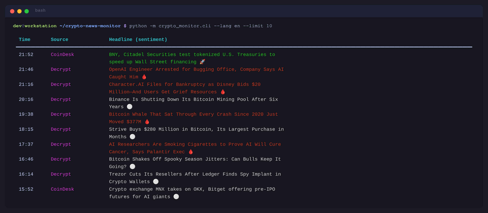
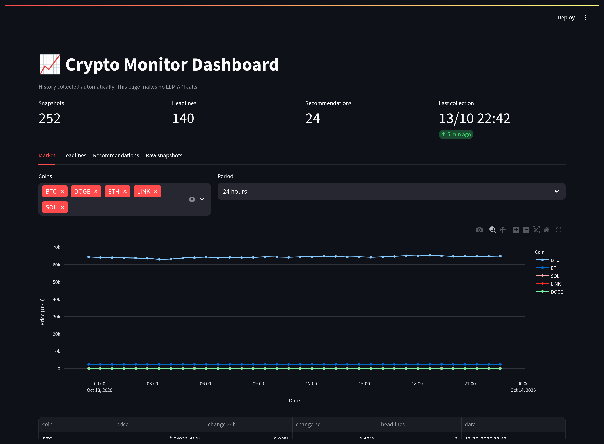
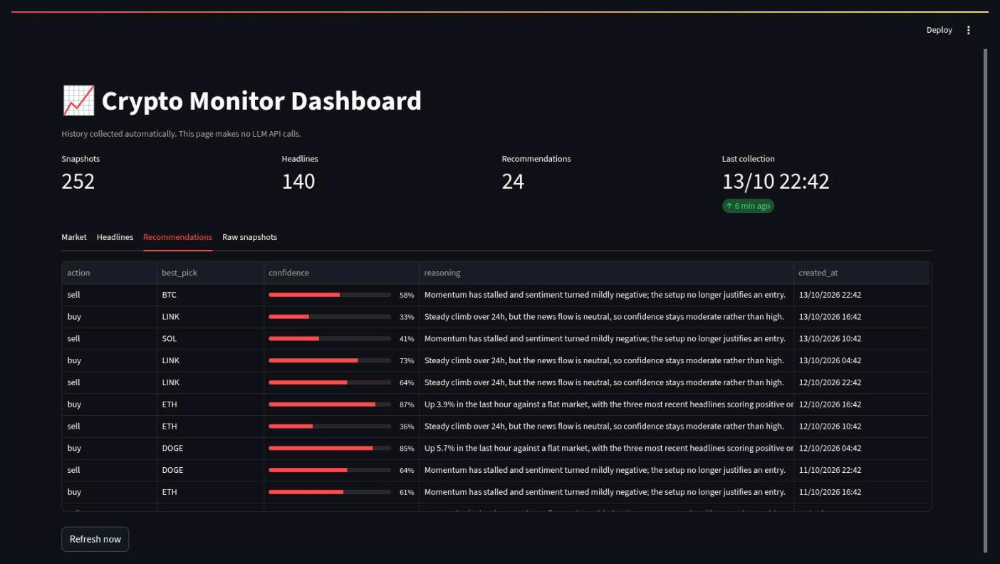

# Crypto News & Market Monitor

**An unattended bot that reads crypto news, scores its sentiment, tracks live prices and sends you a trade signal on Telegram — with a stop-loss that fires even when the AI says "hold".**

Traders lose money to two things: missing the headline that moved the market, and holding a losing position because nobody told them to get out. This project watches both for you, around the clock, from a single Docker command.

---

## What it does

| | |
|---|---|
| 📰 **Aggregates news** | Pulls headlines from six RSS sources (CoinDesk, Cointelegraph, Decrypt, Ethereum Foundation, and two Portuguese portals). No paid news API, no rate limits. |
| 🧠 **Scores sentiment** | Runs every headline through VADER and colours it bullish 🚀 / bearish 🩸 / neutral ⚪. |
| 💹 **Tracks prices** | Live quotes from CoinGecko, overridden by the Binance spot pair when it exists — a quote closer to real time. |
| 📡 **Volatility radar** | Scans the top market-cap coins each cycle and surfaces the sharpest 1-hour movers, filtered to what is actually tradable on Binance Spot (or Alpha). |
| 🤖 **AI buy/sell signal** | Feeds prices, 1h/24h/7d changes, scored headlines and recent history to Google Gemini, which answers in strict JSON with a pick, a rationale and a confidence score. |
| 🛡️ **Mechanical guardrails** | Stop-loss, take-profit and a maximum holding time are enforced in code. If the model says "hold" but the stop-loss is hit, the position is closed anyway. |
| 💬 **Telegram control** | Ten commands to inspect, force-sell, skip or block a coin — the bot is steerable from your phone. |
| 📊 **Dashboard** | A Streamlit page over the MongoDB history: price charts, headlines, past recommendations. Costs zero API tokens to open. |
| ⏰ **Schedule-aware** | Outside the configured active window it stays silent instead of waking you at 3 a.m. — but still protects an open position. |

---

## Tech stack

**Python 3.11** · **Google Gemini** (LLM analysis) · **VADER** (sentiment) · **feedparser** (RSS) · **CoinGecko & Binance APIs** · **MongoDB** (history) · **Streamlit + Plotly** (dashboard) · **Telegram Bot API** · **Docker Compose** · **systemd** (optional bare-metal scheduling)

---

## Architecture

```
          RSS feeds              CoinGecko / Binance
              │                           │
              ▼                           ▼
        ┌───────────────────────────────────────┐
        │           market_monitor              │   ← runs every N minutes
        │  headlines + VADER + prices + radar   │
        └───────────────┬───────────────────────┘
                        │
            ┌───────────┴────────────┐
            ▼                        ▼
   ┌─────────────────┐      ┌──────────────────┐
   │  Gemini client  │      │  MongoDB history │──► Streamlit dashboard
   │  (strict JSON)  │      └──────────────────┘
   └────────┬────────┘
            ▼
   ┌─────────────────────────────┐
   │ guardrails: stop-loss,      │
   │ take-profit, max cycles     │
   └────────────┬────────────────┘
                ▼
         Telegram  ◄──►  telegram_bot (command listener)
```

`market_monitor` and `telegram_bot` run as two separate processes sharing one `state.json`, serialised with a file lock so neither corrupts the other's write.

---

## Installation

```bash
git clone https://github.com/<your-user>/crypto-news-monitor.git
cd crypto-news-monitor

python -m venv .venv
source .venv/bin/activate          # Windows: .venv\Scripts\activate
pip install -r requirements.txt

cp .env.example .env               # add your API keys
cp config.example.yaml config.yaml # set your portfolio and watchlist
```

You need at minimum a [Gemini API key](https://aistudio.google.com/apikey) (free tier is enough) for the AI analysis. The news feed works with no keys at all.

### Run with Docker (recommended)

```bash
docker compose up -d
```

That brings up four containers: MongoDB, the monitor loop, the Telegram listener and the dashboard on <http://localhost:8501>.

---

## Usage

### News terminal

```bash
python -m crypto_monitor.cli --lang en --limit 10
```

```
  Time       Source              Headline (sentiment)
 ━━━━━━━━━━━━━━━━━━━━━━━━━━━━━━━━━━━━━━━━━━━━━━━━━━━━━━━━━━━━━━━━━━━━━━━━━━━━━
  20:16      Decrypt             Binance Is Shutting Down Its Bitcoin Mining
                                 Pool After Six Years ⚪
  19:38      Decrypt             Bitcoin Whale That Sat Through Every Crash
                                 Since 2020 Just Moved $377M 🩸
  16:46      Decrypt             Bitcoin Shakes Off Spooky Season Jitters: Can
                                 Bulls Keep It Going? ⚪
```

Other flags:

```bash
python -m crypto_monitor.cli --search bitcoin   # filter by keyword
python -m crypto_monitor.cli --notify           # desktop pop-ups on critical news
python -m crypto_monitor.cli --buy              # ask the AI for the best buy now
python -m crypto_monitor.cli --sell             # ask the AI which position to close
```

### AI recommendation

`--buy` returns a ranked answer with a confidence bar:

```
╭──────────── 🚀 BEST BUY RIGHT NOW (SOL) ─────────────╮
│                                                      │
│ 🏆 Top pick: SOL                                     │
│ 🎯 Model confidence: 72% [██████████████░░░░░░]      │
│                                                      │
│ 📝 Reasoning:                                        │
│ SOL is up 4.1% in the last hour against a flat       │
│ market, and the three most recent headlines score    │
│ positive on VADER with no negative catalyst.         │
│                                                      │
│ 🔄 Runners-up:                                       │
│   • LINK: steady 24h climb but no supporting news.   │
╰──────────────────────────────────────────────────────╯
```

### Telegram commands

| Command | What it does |
|---|---|
| `/status` | Open position, live price, change, stop and target |
| `/prices` | Current prices across portfolio and watchlist |
| `/sell` | Force-close the open position now |
| `/skip` | Discard the current suggestion, get another coin |
| `/block SYMBOL` | Never suggest this coin again |
| `/unblock SYMBOL` | Remove it from the blocklist |
| `/blocked` | List blocked coins |
| `/market spot\|alpha` | Switch the tradable universe of the radar |
| `/balance` | Binance account balance (testnet or live) |
| `/help` | Show all commands |

A trade signal arrives looking like this:

```
🟢 Trade #7 - Buy SOL (confidence 72%, price $142.30, 1h change +4.10%)
Source: volatility radar
📌 Market: Spot (regular direct buy on Binance)
🎯 Take profit: $153.68 (+8.00%)
🛑 Stop loss: $120.96 (-15.00%)
⏱ Re-evaluating this position on the next cycle (~40 min).
```

### Scheduling without Docker

```bash
cp crypto-monitor.{service,timer} ~/.config/systemd/user/
systemctl --user enable --now crypto-monitor.timer
```

---

## Configuration

Everything lives in `config.yaml` (see `config.example.yaml` for the annotated version):

| Section | Controls |
|---|---|
| `gemini` | Model, master on/off switch for AI analysis |
| `portfolio` | Coins you hold, with buy price and quantity |
| `watchlist` | Coins you are considering |
| `notification` | Minimum confidence, alert cooldown, channels |
| `trading` | `stop_loss_pct`, `max_cycles_held` |
| `schedule` | Active window of the day, UTC offset |
| `binance` | Read-only balance integration, testnet by default |
| `feeds` | RSS sources per language |

Secrets never belong in `config.yaml` — put them in `.env`. Both files are gitignored.

---

## Safety notes

- The Binance integration is **read-only**. This project never places an order.
- It defaults to the **Binance Testnet** (paper balance) and has to be explicitly switched to a live account.
- AI signals are **suggestions, not financial advice**. The guardrails exist to bound losses, not to guarantee gains.

---

## Screenshots

### Headline feed with sentiment scoring



Live headlines from six sources, each scored by VADER and coloured bullish 🚀 / bearish 🩸 / neutral ⚪.

### Dashboard



The Streamlit page over the MongoDB history. Opening it costs nothing in API tokens.



Every past recommendation with its confidence score and the reasoning behind it.

> Want the dashboard populated without waiting a day for real data? Run
> `python examples/seed_demo_data.py` to write a synthetic week of history.

> Still to capture, since they need live credentials:
>
> - [ ] **`cli-recommendation.png`** — `python -m crypto_monitor.cli --buy`, showing the recommendation panel and confidence bar. Needs a Gemini API key.
> - [ ] **`telegram-signal.png`** — a buy signal followed by the sell that closed it, in your Telegram chat.
> - [ ] **`telegram-commands.png`** — the `/status` and `/prices` answers.
> - [ ] **`docker-ps.png`** — `docker compose ps` with the four containers up.

---

## License

MIT — see [LICENSE](LICENSE).
